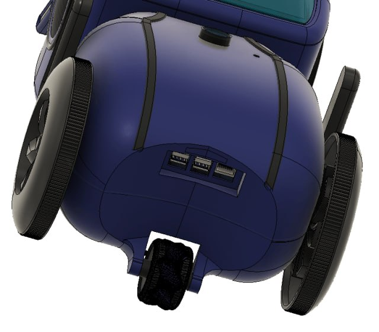
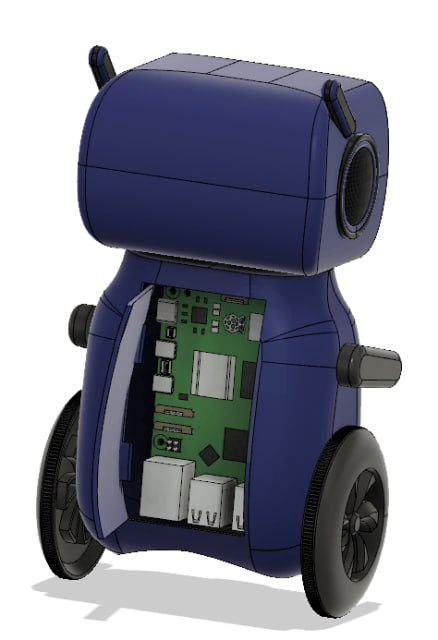
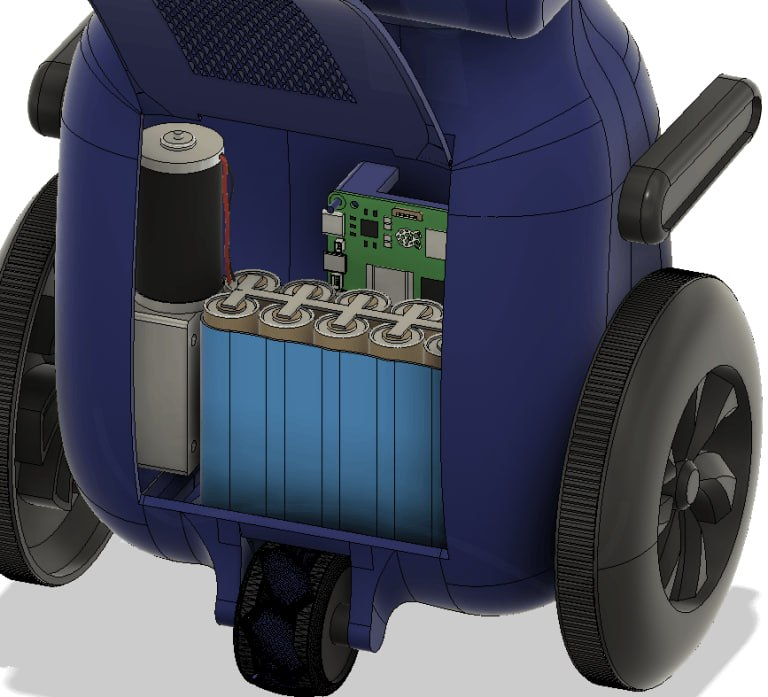

# AVA-ROBOT

**A mobile AI companion robot powered by Hermes Agent.**
Built by Aalind Tiwari.



AVA is a wheeled AI companion with a touchscreen, camera, speaker, sensors and motors, all packed into a 3D-printed enclosure. A single-board computer runs the high-level AI, a **XIAO ESP32-S3 Sense** handles audio/IMU sensing and motor control, and a custom carrier board ties the power and drive system together.




## Architecture (6 layers)

| # | Layer | Runs on | What it does |
|---|-------|---------|--------------|
| 1 | **AVA Sense** | XIAO ESP32-S3 Sense | PDM microphone, OV3660 camera, LSM6DS3 IMU — captures raw signals |
| 2 | **AVA Bridge** | XIAO ESP32-S3 | Streams audio over WiFi; tap-to-wake via IMU |
| 3 | **Context Fusion** | Ubuntu server | VAD → Whisper transcription → timestamped events |
| 4 | **Knowledge Graph** | Ubuntu server | SQLite-backed graph of people, topics and relationships |
| 5 | **Intelligence Engine** | Ubuntu server | Pattern detection, commitments, mood tracking, proactive nudges |
| 6 | **Action Surface** | Telegram | Text/voice notifications and daily briefings |

## Hardware

The custom carrier board (v1, routed) manages power and drive:

- **Power:** 2S LiPo → slide switch → 5A polyfuse → 5V/5A buck module → SBC + logic
- **Drive:** TB6612FNG dual motor driver (motor rails run straight off the battery)
- **Brain socket:** XIAO ESP32-S3 Sense (audio + IMU + I2C + motor control GPIOs)
- **Expansion:** Qwiic-style I2C connector, status LEDs for both rails

Files:

- [`hardware/ava-carrier.kicad_sch`](hardware/ava-carrier.kicad_sch) — KiCad schematic (v1)
- [`hardware/ava-carrier-schematic.pdf`](hardware/ava-carrier-schematic.pdf) — printable render
- [`hardware/ava-carrier.kicad_pcb`](hardware/ava-carrier.kicad_pcb) — KiCad routed PCB (60 x 40 mm, 2-layer, DRC-clean)
- [`hardware/fabrication/ava-carrier-v1-gerbers.zip`](hardware/fabrication/ava-carrier-v1-gerbers.zip) — fabrication package (Gerbers + Excellon drill)
- [`bom.csv`](bom.csv) — bill of materials


## Firmware (XIAO ESP32-S3 Sense)

PlatformIO project. Put your WiFi credentials in `firmware/src/main.cpp`, then:

```bash
cd firmware
pio run --target upload
pio device monitor
```

Note: the ESP32-S3 only has a 2.4GHz radio — use your network's 2.4G SSID.

## Server (Ubuntu)

```bash
cd server
python3 -m venv venv
source venv/bin/activate
pip install -r requirements.txt
python3 ava_server_v2.py   # ws://0.0.0.0:5013
```

`dashboard.py` serves a status page on port 5014, or use `./run_server.sh`.

## Repo layout

```
├── firmware/        # PlatformIO firmware for the XIAO ESP32-S3 Sense
├── server/          # WebSocket audio receiver + Whisper + intelligence engine
├── hardware/        # Carrier board: KiCad schematic + routed PCB + gerbers
│   └── fabrication/ # Gerber + drill fabrication package (zip)
├── images/          # CAD renders and build photos
├── bom.csv          # Carrier board bill of materials
├── BOM.md           # Parts funding tracker (mirrored from Half Life)
└── JOURNAL.md       # Devlog (mirrored from Half Life)
```

## License

MIT — original CAD, schematics and code in this repo are free to use and modify.
