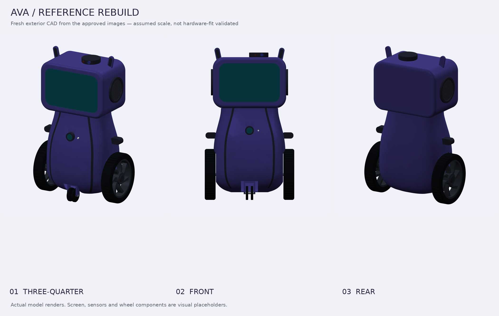
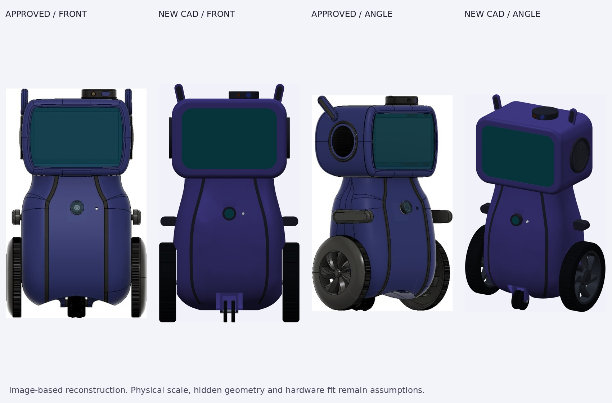
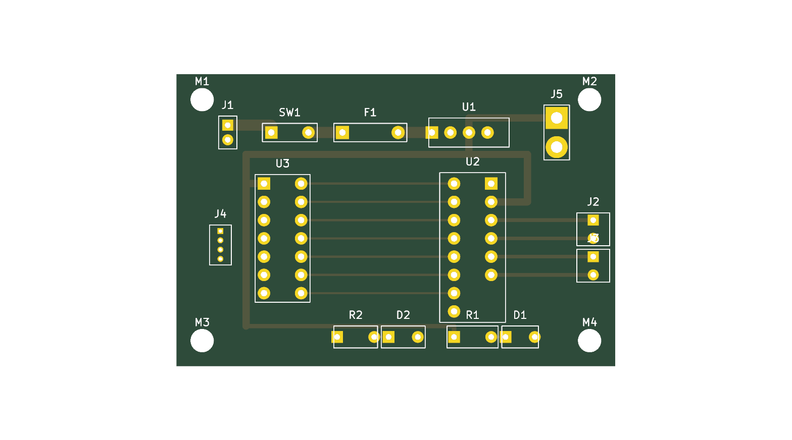

<div align="center">

# AVA — an AI companion with a physical body

**A wheeled robot project for [Half Life](https://halflife.hackclub.com) by Hack Club.**

Built by **Aalind Tiwari**, with AI-assisted CAD and development.

[Explore the CAD](cad/reference-rebuild/) · [Download STEP](https://github.com/AalindOg/AVA-Robot-/raw/refs/heads/main/cad/reference-rebuild/exports/AVA-reference-rebuild.step) · [View STL](cad/reference-rebuild/exports/AVA-reference-rebuild.stl) · [Development journal](JOURNAL.md)



*Actual renders of the current model. Not photographs of a fabricated robot.*

</div>

## What I’m building

AVA is a mobile AI companion: a screen for expression and interaction, cameras and microphones for sensing, speakers for responses, and a wheeled body. The longer-term goal is to connect that body to **Hermes Agent**, with a small controller handling the hardware interface and a computer handling higher-level processing.

This repository brings together three parts of that project: the **exterior CAD**, the **carrier-board design**, and the **firmware/server prototypes**. They are at different stages. The integrated, moving robot is not finished.

## Current milestone: a new body from the original references

The earlier STL attempt did not match the intended robot. Instead of polishing the wrong shape, this version was rebuilt from the original purple robot images and the surviving video views. The older meshes are not imported by the new model.

The design keeps the features that made the reference worth building:

- A **closed, rounded head** with a broad teal screen and thick bezel.
- Circular side grilles, flat antenna tabs and a low roof-mounted sensor housing.
- A curved torso with a narrower upper section, rounded lower body and dark panel trim.
- Two large treaded wheels with swept-spoke hubs.
- A small central twin-wheel caster, short side pods and a circular chest detail.



*Reference and reconstruction side by side. Fine seams, hidden surfaces and small hardware details are still approximate.*

> [!IMPORTANT]
> **This is an exterior design prototype, not a print-ready robot kit.** The STL files are real geometry exports, but the dimensions are image-based assumptions. Motor mounts, electronics packaging, joints, tolerances and print orientations still need engineering and physical tests. Do not print the complete assembly expecting a working robot.

## Get the files

| File | Use it for |
| --- | --- |
| [**Full STEP assembly**](https://github.com/AalindOg/AVA-Robot-/raw/refs/heads/main/cad/reference-rebuild/exports/AVA-reference-rebuild.step) | Import named, coloured solid components into FreeCAD, Fusion or Onshape. |
| [**Full STL assembly**](cad/reference-rebuild/exports/AVA-reference-rebuild.stl) | Inspect the complete geometry; this is a multi-component assembly, not one fused print. |
| [**Individual STL components**](cad/reference-rebuild/exports/parts/) | Inspect or modify separate shell sections, wheels, trim and other components. |
| [**Coloured GLB model**](https://github.com/AalindOg/AVA-Robot-/raw/refs/heads/main/cad/reference-rebuild/exports/AVA-reference-rebuild.glb) | Open in a compatible 3D viewer. Uses metres and +Y up. |
| [**CadQuery source**](cad/reference-rebuild/cad/build_robot.py) | Edit the construction and regenerate the geometry. |
| [**Design notes**](cad/reference-rebuild/DESIGN-NOTES.md) | Read the assumptions, interpretation choices and verification scope. |
| [**Printing status**](cad/reference-rebuild/PRINTING.md) | See what must be resolved before a physical prototype. |

For everything, use GitHub’s **Code → Download ZIP**, or clone this repository. STEP/STL use millimetres. STEP contains editable solids; the procedural construction lives in the Python source, not a native CAD feature-history tree.

## What has actually been checked

The current CAD export contains **38 component instances**. They include visual stand-ins for screens, sensors and axles—not 38 fabrication-ready parts.

| Check | Recorded result | Evidence |
| --- | --- | --- |
| Solid geometry | All 38 component instances valid, with positive volume | [Geometry report](cad/reference-rebuild/exports/validation.json) |
| Component clashes | No intersections above the **0.5 mm³** reporting threshold; no check errors | [Pairwise check](cad/reference-rebuild/exports/validation.json) |
| STL quality | Every individual STL is watertight, consistently wound, finite and positive-volume | [Mesh report](cad/reference-rebuild/exports/mesh-validation.json) |
| STEP round trip | Re-imported successfully; solid count and volume comparison passed | [Round-trip result](cad/reference-rebuild/exports/mesh-validation.json) |
| Viewer export | GLB re-imported with all 38 components | [Viewer check](cad/reference-rebuild/exports/mesh-validation.json) |
| Visual review | Front and angled views compared with the approved images | [Comparison sheet](cad/reference-rebuild/images/reference-comparison.jpg) |

The assumed exterior envelope is approximately **232 × 147 × 394 mm** (width × depth × height). Head width was set to **190 mm** as a scaling choice, not a measurement from a physical robot.

**These checks establish coherent files. They do not establish strength, stability, printability, electronics fit or successful motion.**

### What changed during this iteration

- Closed the head rather than reproducing the rejected open-top shape.
- Refined the lower-body curve, screen opening, wheel scale, antenna angle and sensor placement against the references.
- Replaced side-pod geometry that produced non-watertight STL exports.
- Fixed a shell-splitting operation that returned an empty result despite reporting valid topology.
- Used matching numerical integration tolerances when comparing STEP export/import volumes.

The useful outcome is not just a better render: the source, exported solids and validation reports are all here to inspect.

## Carrier board and electronics

The existing v1 carrier-board design is retained alongside the new CAD. It includes a battery input and power switching, a buck-module connection, a TB6612FNG motor-driver module socket, a XIAO ESP32-S3 Sense socket, motor connectors and an I²C expansion connector.



- [KiCad schematic](hardware/ava-carrier.kicad_sch)
- [Schematic PDF](hardware/ava-carrier-schematic.pdf)
- [KiCad PCB layout](hardware/ava-carrier.kicad_pcb)
- [Gerber and drill package](hardware/fabrication/ava-carrier-v1-gerbers.zip)
- [Carrier-board BOM](bom.csv)

**The carrier board and the new enclosure have not been physically integrated or fit-tested.** The board files and fabrication exports are design artifacts, not evidence that a board was manufactured or powered successfully. Check component ratings and footprints before ordering or connecting a battery.

The [CAD component inventory](cad/reference-rebuild/bom.csv) is separate from the electronics BOM: it lists visual model instances, not parts to purchase.

## Software direction

The repository also retains:

- [`firmware/`](firmware/) — PlatformIO/Arduino sources for the ESP32-S3 sensing and bridge work.
- [`server/`](server/) — Python audio-receiver, transcription, dashboard and intelligence experiments.

The intended division is simple: the controller handles device I/O; the computer handles processing and agent behaviour. These are **prototype sources**, not proof of a working end-to-end robot. Their runtime and physical integration were not revalidated as part of this CAD update.

## Rebuild the CAD

Tested with Python 3.12 and CadQuery 2.8.0. From the repository root on Linux/macOS:

```sh
cd cad/reference-rebuild
python3 -m venv .venv
.venv/bin/python -m pip install -r requirements.txt

# Generate parts, assembly and geometry checks
.venv/bin/python cad/build_robot.py

# Check all meshes, re-import STEP and export GLB
.venv/bin/python cad/validate_meshes.py

# Render the actual exported geometry and compare with references
.venv/bin/python cad/render_robot.py
.venv/bin/python cad/compare.py
```

The model is editable procedural CAD, not a fully constrained configurator. Major dimensional changes also require checking the inner shell, openings and neighbouring components. Rerun the checks after edits. More details: [CAD README](cad/reference-rebuild/README.md).

## Next steps toward a physical robot

- [ ] Select and measure the actual display, motors, battery and controller boards.
- [ ] Add motor mounts, bearings, electronics mounts and battery retention.
- [ ] Design shell fasteners and access to the hardware inside.
- [ ] Resolve the caster mount, swivel clearance and wheel-to-shaft interfaces.
- [ ] Check wiring paths, ventilation and battery/power safety.
- [ ] Slice individual parts and print fit-test pieces before a full enclosure.
- [ ] Assemble, test movement and connect the hardware to the software stack.

## Half Life journal and credits

The [development journal](JOURNAL.md) and [funding tracker](BOM.md) are mirrored from [Half Life](https://halflife.hackclub.com). Those files are managed by the platform; this update leaves them unchanged. The CAD rebuild is documented here and in [design notes](cad/reference-rebuild/DESIGN-NOTES.md), rather than inventing hours or modifying past entries.

**AI assistance is part of this work.** Aalind selected the reference design, rejected the earlier model and directed the rebuild. Ava/Hermes assisted with procedural CAD generation, debugging, validation, rendering and documentation. This repository does not claim the generated work was completed unaided, that it has already been accepted for a particular week, or that the physical robot has been built.

The source images are kept separately in [references](cad/reference-rebuild/references/) so readers can distinguish the design references from the new model renders. [Provenance notes](cad/reference-rebuild/references/provenance.json) describe the surviving source copies; their original author/license is not independently established here.

## Repository map

```text
cad/reference-rebuild/
├── cad/                # Build, render, compare, validate and package scripts
├── exports/            # STEP, STL, GLB, inventory and validation reports
│   └── parts/          # Individual component-instance STLs
├── images/             # Current renders and reference comparison
├── references/         # Source reference views, kept distinct from outputs
├── DESIGN-NOTES.md
└── PRINTING.md
hardware/               # Existing carrier schematic, PCB and fabrication exports
firmware/               # Existing microcontroller prototypes
server/                 # Existing Python prototypes
bom.csv                 # Carrier-board parts list
BOM.md                  # Half Life-managed funding tracker
JOURNAL.md              # Half Life-managed devlog
```

## License and reference assets

The project’s existing MIT declaration applies to its original code and design contributions. Supplied reference images are **not** being relicensed by this update; their provenance and usage rights should be checked before reuse outside this project.
